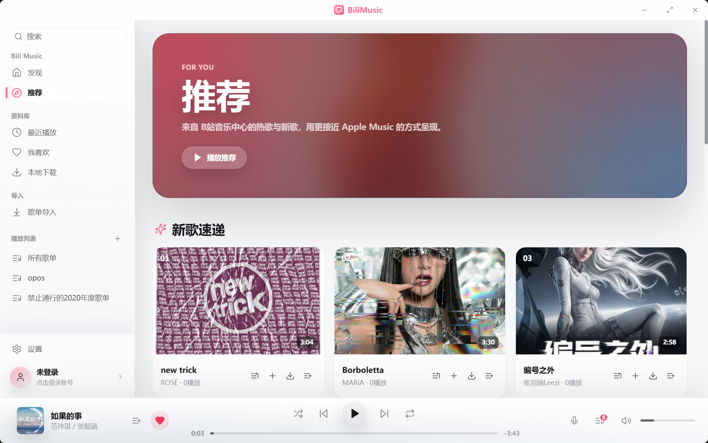
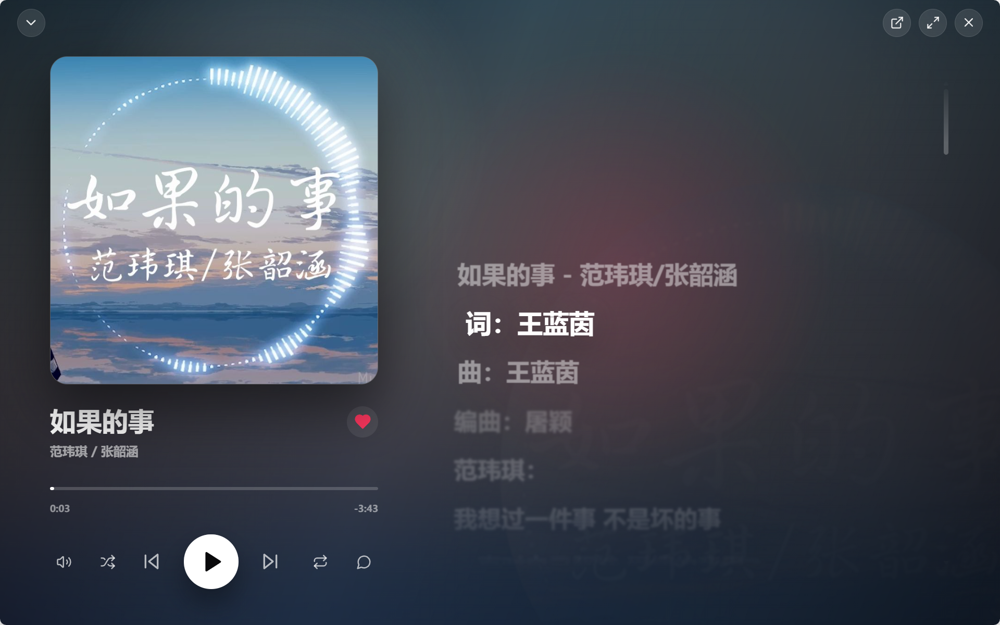
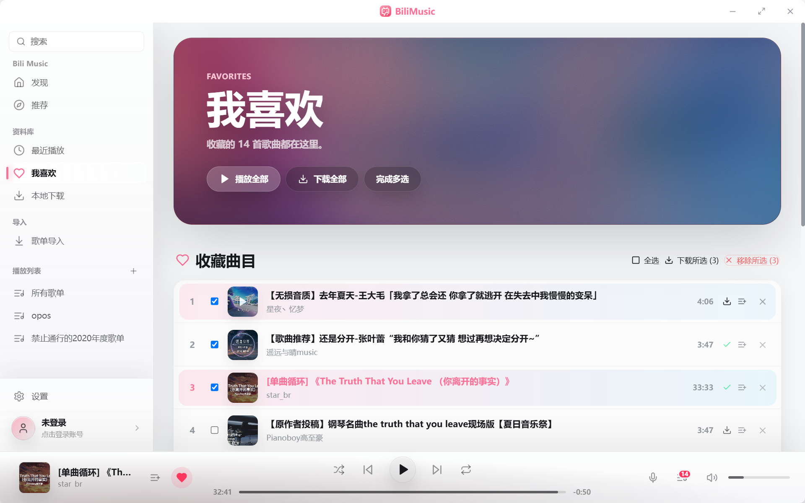
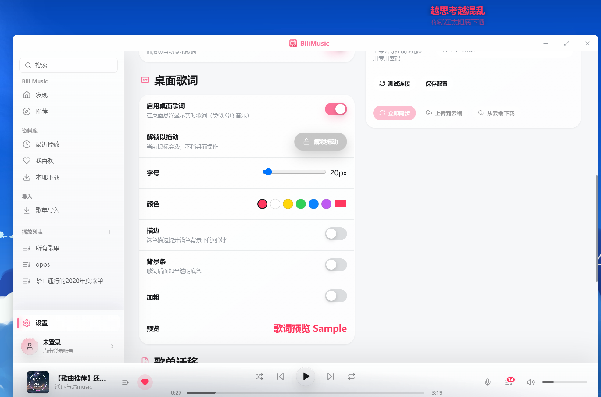
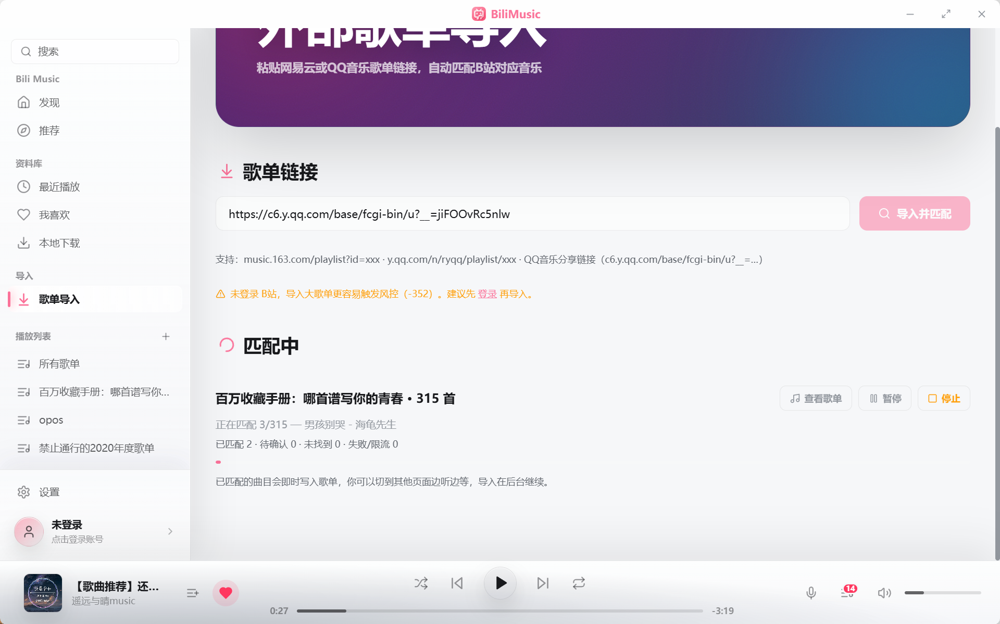

<div align="center">
  
  <h1>BiliMusic · Enhanced Edition</h1>
  <p>
    <strong>把 Bilibili 变成一座精致、灵动、支持离线秒播的 Apple Music 风格桌面音乐资料库。</strong>
  </p>
  <p>
    <em>本项目基于原作者 <a href="https://github.com/HanversionOvO/BiliMusic">@HanversionOvO/BiliMusic</a> 进行深度二次开发与体验重构</em>
  </p>
  <p>
    <a href="#-二创增强特性亮点">二创增强亮点</a>
    ·
    <a href="#-功能全景与界面">功能展示</a>
    ·
    <a href="#-快速开始">快速开始</a>
    ·
    <a href="#-构建与打包">构建与打包</a>
    ·
    <a href="https://github.com/Withnoidea/BiliMusic">GitHub</a>
  </p>
  <p>
    
    
    
    
    
  </p>
</div>

<br />

<div align="center">
  <table>
    <tr>
      <td align="center" width="25%">
        <h3>🎵 本地离线秒播</h3>
        <p>下载完整性校验，已缓存音频 0 流量 0 延迟秒播，断网无忧。</p>
      </td>
      <td align="center" width="25%">
        <h3>📥 MP3 转码与批量下载</h3>
        <p>默认 320kbps MP3 转码与 ID3 标签写入，多选批量下载、全局 2 并发调度。</p>
      </td>
      <td align="center" width="25%">
        <h3>✨ 沉浸动态光晕</h3>
        <p>智能提取封面主色，自适应底栏流光氛围与细腻淡入淡出。</p>
      </td>
      <td align="center" width="25%">
        <h3>📋 外部歌单智能导入</h3>
        <p>支持外部歌单迁移，基于歌名/歌手/时长的智能模糊候选匹配。</p>
      </td>
    </tr>
  </table>
</div>

<br />

## 🌟 二创增强特性亮点 (What's Enhanced)

在原作者优秀的前端架构与 Apple Music 设计语言之上，针对长期日常听歌的**稳定性、音质播放流、离线能力与交互细节**进行了全方位的深度打磨与工程重构：

### 1. 本地音频离线秒播链路 (Local Priority Playback)
- **0 流量秒开**：点击播放时优先探测本地下载库，通过哈希与文件完整性校验后，以主进程安全流直接驱动播放，彻底摆脱 B 站 CDN 波动与网络依赖。
- **平滑换链兜底**：本地未下载时自动请求 B 站流媒体，若遇到 CDN 鉴权过期或流阻断，后台具备静默刷新与超时重试兜底，切歌不再报错卡死。

### 2. 批量下载管理、MP3 转码与文件防护

- **默认 320kbps MP3 转码**：内置 FFmpeg 转码管道，默认导出高兼容性 320kbps MP3 格式，并写入 ID3v2 标题、歌手、专辑及封面封绘（同时支持在设置中切换回原源 M4A）。
- **多选批量下载**：支持在“我喜欢”及各大歌单中一键开启多选模式，批量提交下载任务。
- **并发与反爬保护**：采用全局 2 并发调度队列，下载与转码状态解耦，防止瞬间并发过高触发 B 站 412/429 访问限制。
- **原子提交写盘**：下载临时文件校验成功后再执行原子替换，杜绝断网或强退导致的半截破损音频。支持自定义下载目录与一键在资源管理器中定位。

### 3. 现代化视听微交互与动效
- **底栏交互与悬停提示**：播放控制栏所有功能按钮全面补齐中文原生悬停提示（Tooltip），三种循环模式（顺序播放 / 列表循环 / 单曲循环）具备清晰的色彩标识、状态角标与即时 Toast 反馈。
- **模式逻辑严格对齐**：单曲循环就地重新播放、列表循环无缝衔接随机队列、顺序播放队尾平稳停止。
- **封面自适应氛围光 (Ambient Light)**：底栏播放器实时提取当前封面主色阶，呈现呼吸感柔和背景光晕。
- **150ms 软性 Crossfade**：切歌与跳转进度时微调淡入淡出曲线，消除数字音频突兀起音的爆音不适。
- **长音频断点记忆**：针对电台、播客、长合集（>15分钟）自动记录播放位置，二次进入平滑续播。

### 4. 真实动态推荐与纯净音乐发现
- **多源混合动态推荐**：结合首页推荐、关注动态、近期播放相关歌曲及新曲等多重数据流，刷新与“换一换”时引入随机 seed、分区及分页深度轮替，告别千篇一律。
- **严苛音乐内容清洗**：限制时长为 60–600 秒，过滤教程、开箱、评测、伴奏求谱等非听歌向视频，优先歌曲特征加权，杜绝劣质杂谈。
- **跨页会话级智能去重**：推荐与发现页面共享渲染会话级已展示集合，杜绝翻页频繁重复。

### 5. 独立置顶桌面歌词 (Desktop Lyrics)
- 独立置顶透明歌词窗口，支持流光字色与阴影渲染。
- 支持锁定穿透、无干扰拖拽停靠与双行歌词预读，全屏游戏或码字时听歌更沉浸。

### 6. 跨平台歌单迁移助手 (Smart Playlist Import)
- 支持外部平台歌单 JSON / 文本导入。
- 内置多维模糊匹配算法（歌名 + 歌手 + 时长置信度打分），并提供清晰的手动修正候选浮窗。

### 7. 系统级防御与进程健壮性
- **防多开守护**：单实例互斥锁（Single Instance Lock），重复双击自动唤醒已有主窗口，彻底解决后台多开堆叠。
- **生产级凭据与特权隔离**：生产包彻底禁用 `17689` 调试端口；B站登录凭据（SESSDATA / bili_jct）严格收敛于主进程安全会话；全窗口开启 `contextIsolation` 与原生路径白名单校验。

---

## 📸 功能全景与界面展示

### 1. 沉浸式音乐主界面与氛围光
*展示包含侧边栏导航、推荐歌曲流，以及正在播放时的封面主色自适应氛围底栏。*

<div align="center">
  
</div>

<br />

### 2. 沉浸式播放器与歌词面板
*展示大封面背景虚化弥散、唱片动效与右侧高精细度歌词滚动联动界面。*

<div align="center">
  
</div>

<br />

### 3. 歌单多选与批量离线下载
*支持在“我喜欢”等歌单中一键开启多选模式，批量勾选歌曲进行温和队列下载。*

<div align="center">
  
</div>

<br />

### 4. 独立悬浮桌面歌词
*桌面歌词设置与悬浮预览效果，支持半透明无感穿透、字号与颜色自定义。*

<div align="center">
  
</div>

<br />

### 5. 跨平台歌单智能匹配导入
*支持粘贴网易云/QQ音乐外部歌单链接，后台自动解析并在 B 站进行多维置信度匹配与导入。*

<div align="center">
  
</div>

---

## 🚀 快速开始

### 运行环境要求
- **Node.js**: >= 18.0.0
- **npm** 或 **pnpm**
- **操作系统**: Windows 10/11 x64 (macOS / Linux 亦支持前端开发)

### 本地启动与调试

```bash
# 1. 克隆本项目
git clone https://github.com/Withnoidea/BiliMusic.git
cd BiliMusic

# 2. 安装项目依赖
npm install

# 3. 启动本地开发服务（同时启动 Vite + Electron 窗口）
npm run electron:dev
```

---

## 📦 构建与打包

生产构建会自动进行 TypeScript 类型核验、Vite 前端压缩、preload 脚本同步与 Electron 打包：

```bash
# 执行前端与主进程编译检查
npm run build

# 执行自动化回归测试
npm test

# 打包产出 Windows 安装包与免安装版本
npm run electron:build
```

**打包构建产物将输出在 `release/` 目录下**：
- **免安装绿色便携版**：`release/BiliMusic-<version>-win-x64-portable.zip`
- **免安装解压目录**：`release/win-unpacked/BiliMusic.exe`
- **NSIS 独立安装包**：`release/BiliMusic-Setup-<version>-x64.exe`

---

## 🛠️ 项目技术栈

- **Core**: Electron 36 (全沙箱架构 + IPC 严格授权)
- **Frontend**: React 19 + TypeScript + Vite 6
- **UI & Motion**: Tailwind CSS + Framer Motion (弹性动效)
- **Iconography**: Lucide React
- **Audio & Media**: HTML5 Web Audio API + FFmpeg (ID3 标签注入与 320kbps MP3 转码) + 自研流式网关
- **Test**: Node.js Test Runner + 包内 Electron 冒烟测试套件

---

## 🙏 致谢与开源协议

- **原始项目**：特别感谢原作者 [@HanversionOvO](https://github.com/HanversionOvO) 开源的原版 [BiliMusic](https://github.com/HanversionOvO/BiliMusic)，提供了优异的视觉设计与跨平台基础架构。
- **社区友链**：[LINUX DO](https://linux.do/) —— 新一代极客与开源探索技术社区，真诚、友善、团结、专业。
- **开源协议**：本项目沿用 [MIT License](./LICENSE) 开源协议。本软件仅供学习交流使用，音频版权归原视频创作者及哔哩哔哩平台所有。

## 本 fork 的检查更新与发布

- 当前维护仓库：[Withnoidea/BiliMusic](https://github.com/Withnoidea/BiliMusic)。
- 安装包与版本说明：[Releases](https://github.com/Withnoidea/BiliMusic/releases)；问题反馈：[Issues](https://github.com/Withnoidea/BiliMusic/issues)。
- 客户端仅从本 fork 检查与下载更新，不回退到原作者的更新源。尚未发布正式 Release 时显示“暂无可用的正式发布版本”，不误报“已是最新版本”。
- 未提供 `ota.json` 时检查本 fork 的最新正式 Release，有新版本则引导手动下载；完整自动更新需要一并发布安装包、`latest*.yml` 和 OTA 清单等资产。
- 保留原应用 ID、已有歌单与登录存储；旧上游 OTA 缓存不再覆盖本 fork 内置界面。原作者署名与致谢保留。
- 发布步骤、版本规则和各平台更新限制见 [发布说明](docs/RELEASING.md)。
